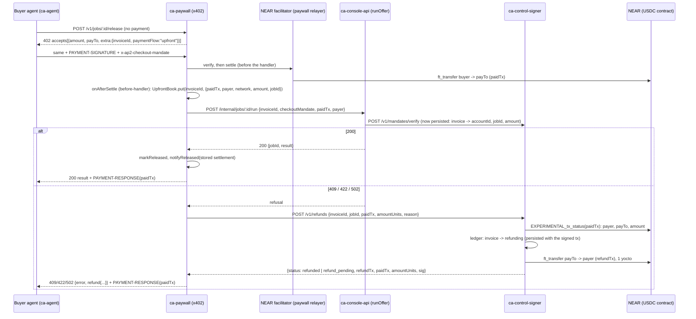

# privateAI-design-37: pay before work, automatic refund (x402 upfront + ChainAim's signer refunds)

Chat near-ai-impl-12, 2026-11-13 ~10:30Z. Must-do item 1 of the near-ai-impl-11 table. Owner decisions (handoff):
"money reaches ChainAim before any work; no one can dupe the other"; PoC = Option 1 (x402 upfront + automatic refund by
ChainAim's signer); Option 2 (NEAR yield/resume contract + escrow scheme) = roadmap (table row 8). Release target: v2.1.0.
Status: DESIGN ONLY. No code changed. Punchline: **"ChainAim never works unpaid; you never pay for a failed job."**

## 0. Sources (Rule 3: what was read, what was carried over, what is assumed)

Read in this chat (repo copy `<your-folder>\chainiam-private-ai`, v2.0.0 code):
- services/paywall/src/app.ts (whole): onBeforeVerify (invoice claim), onSettleFailure, onAfterSettle (payment log,
  `jobs.markReleased`, `notifyReleased`), `release()`, `runOffer()` (409/422 passed on as "you were not charged"; 502 on
  timeout/unreachable/bad body), release guard before the payment middleware, AsyncLocalStorage `marks` (phase log only).
- services/paywall/src/routes.ts (tail): the `POST /v1/jobs/:id/release` entry, one NEAR USDC accept, `extra: { invoiceId }`.
- services/paywall/src/config.ts: PAID_JOBS_* variables (KEY, RESULT_URL, TTL_SEC, CLOCK_SKEW_SEC, MAX, RUN_TIMEOUT_SEC).
- services/paywall/src/jobs.ts: JobBook `beginPaying / endPaying / markReleased / isRun / state`.
- packages/signer/src/index.ts (whole): allowlist (`onlyFields`, `RE`), `SellerSigner` (in-memory `nonces` map only,
  `verifyMandate`, `signReceipt`, `settle`), `SignerApi`.
- services/signer/src/main.ts (flags; routes :149-154) and services/signer/Dockerfile: "zero npm dependencies",
  "stateless except the in-memory set of accepted mandate nonces" (ARCH-660).
- test-console/console/server.ts:376-470 (`runOffer`, `onJobReleased`), jobs.ts:183-219 (`RunNotice`, `parseRunNotice`).
- services/paywall/scripts/agent-jobs-core.ts:436-487 (payAndFetchNear, `paid.receipt`, `fail(..., transaction)`, the
  spend ledger written only after a 200).
- Grep over the staged sources for `paymentFlow|upfront|refund`: no hit in code (only an old "refund letter" example).

Carried over from near-ai-impl-10 (verified there by reading node_modules; NOT re-read in this chat because the device
link dropped while staging `@x402/core/dist/cjs/server/index.js`; implementation step 0 re-reads them):
- F1 @x402/core 2.29.0 implements the flows authorization | upfront | escrow (dist/cjs/server/index.js:428-445).
- F2 @x402/near 2.29.0 exact server supports ["authorization","upfront"] (exact/server/index.js:90); the flow is chosen
  by `requirements.extra.paymentFlow`.
- F3 the @x402/near facilitator settles with exactly one ft_transfer to payTo (facilitator/index.js:310); settle() re-runs verify().
- F4 beforeVerify hooks always run. With upfront, settle runs BEFORE the handler; a handler answering >= 400 after an
  upfront settle fires `onVerifiedPaymentCanceled` (phase "cancel"); PAYMENT-RESPONSE echoes the before-handler settlement
  (server/index.js:488-496).
- F5 the client (scripts/near.ts:179-188) reads payment-response on any status; services/web/src/near-payment.ts passes
  `extra.paymentFlow` through.

Assumptions (flagged; each has a check in §9 step 0):
- A1 onAfterSettle runs inside the request's async context in the upfront phase too (today the phase log relies on it
  for the authorization phase: `mark()` in onAfterSettle).
- A2 the paid tx's outer signer is the paywall's NEAR relayer account (the delegate's sender is the buyer), so the signer
  looks the tx up with `EXPERIMENTAL_tx_status {tx_hash, sender_account_id: <relayer>}` and finds the ft_transfer
  receipt whose predecessor is the buyer.
- A3 re-broadcasting the identical signed NEAR transaction is idempotent (same hash; the chain does not execute it twice).
- A4 packages/agent-policy's spend ledger has `record()` only (not read in this chat); a `refund()` credit is added.

## 1. Problem

Today (authorization flow) the paywall verifies the buyer's signed payment, runs the job, and settles only on a 2xx.
ChainAim does the work (model calls, NEAR AI cost) before it holds any money; a buyer whose delegate becomes invalid
(account drained, nonce used elsewhere) between verify and settle gets a free result. The demo video's step 3 ("work
first, then the money settles") states exactly that.

## 2. Target behaviour

| Case | Authorization flow (today, stays the default) | Upfront flow (new, `PAID_JOBS_FLOW=upfront`) |
|---|---|---|
| Good run | verify → run → 200 → settle → released → receipt | verify → **settle** → run → 200 → released → receipt (records paidTx) |
| Console refuses (409 over estimate, 422 mandate / no result / no attestation) | verify → run → 409/422 → nothing settles | verify → settle → run → 409/422 → **signer refunds** → body carries the signed refund |
| Console unreachable / timeout / bad body (502) | nothing settles | settle → 502 → refund |
| Paywall crashes between settle and answer | n/a | the refund is still owed: `GET /v1/refunds/:invoiceId` + owner `-Refunds -RefundRetry` (§6) |
| Settle fails | x402 answers before the handler, no work | same: no work, nothing to refund |

Invariant **I1**: for every invoice whose upfront payment settled, exactly one of {delivered receipt, refund} exists.
Invariant **I2**: a refund goes only to the account that paid (from the chain, cross-checked with the accepted mandate),
never to an account named by a caller. Invariant **I3**: a refunded job can never get a signed receipt, and a job with a
signed receipt can never be refunded.

## 3. Architecture



Planes (design-36 §1) stay: the refund key (the payTo seller wallet key) lives ONLY in ca-control-signer. The paywall
and the console never hold it. The paywall authenticates to the signer with the request key the console already uses
(X-Signer-Key, `SIGNER_REQUEST_KEY`).

## 4. ARCH-IDs (new)

| ARCH | Requirement | Where |
|---|---|---|
| ARCH-670 | `PAID_JOBS_FLOW=authorization\|upfront` (default authorization); upfront puts `extra.paymentFlow:"upfront"` on the release accept; upfront needs the refund URL + request key, start-up refuses otherwise | paywall config.ts, routes.ts |
| ARCH-671 | phase-aware settle hook: a before-handler settlement is stored by invoice (UpfrontBook) and does NOT mark released or notify; release + console notice only after a 200, with the stored settlement | paywall app.ts, new src/upfront.ts |
| ARCH-672 | every non-200 answer of the release handler after an upfront settle asks the signer for the refund before answering and returns `refund{...}`; `onVerifiedPaymentCanceled` is the safety net | paywall app.ts |
| ARCH-673 | signer `POST /v1/refunds`, `GET /v1/refunds/:invoiceId` (X-Signer-Key, allowlist); refund iff paid on chain to payTo for that amount and no receipt delivered; destination = on-chain payer (= mandate accountId when a mandate was accepted); idempotent per invoice | packages/signer, services/signer main.ts |
| ARCH-674 | persisted, signed refund ledger (`--refund-store DIR`, append-only JSONL, fsync): mandate acceptances, delivered marks, refunding (with the signed tx bytes), refunded, refund_failed; replayed at start; pending refunds re-broadcast | packages/signer/src/refund-book.ts |
| ARCH-675 | I3: `signReceipt` refuses (409) a job whose invoice is refunding/refunded; a refund is refused (409) for an invoice whose receipt was signed | packages/signer SellerSigner |
| ARCH-676 | ARCH-660 amended: the signer image may carry the NEAR client packages and a volume; still flags only, keys from env only | services/signer Dockerfile, compose.yml |
| ARCH-677 | agent end states `refunded` / `refund_pending` (refund record verified with the PINNED receipt key); spend ledger counts the upfront payment and the verified refund; tab 03 shows paid → refused → refunded | agent-jobs-core.ts, packages/agent-policy, paid-jobs.html, server.ts console-paid path |

## 5. Detailed changes

### 5.1 Paywall configuration (ARCH-670): services/paywall/src/config.ts

Read only with `PAID_JOBS=on`:

| Variable | Values / default | Check |
|---|---|---|
| `PAID_JOBS_FLOW` | `authorization` \| `upfront`, default `authorization` | anything else: start-up error naming the variable |
| `PAID_JOBS_REFUND_URL` | the signer base URL, e.g. `http://host.docker.internal:8780` | required with upfront; http(s) only |
| `PAID_JOBS_REFUND_KEY_ENV` | env name holding the request key, default `SIGNER_REQUEST_KEY` | with upfront the value must be ≥ 24 chars |
| `PAID_JOBS_REFUND_TIMEOUT_MS` | default 20000, 1000..120000 | the wait for `POST /v1/refunds` |

`PaidJobsConfig` gains `flow: "authorization" | "upfront"` and `refund?: { url, key, timeoutMs }`. The key is never
logged (same rule as PAID_JOBS_KEY). MANUAL_SETUP.md entry in the same turn (CLAUDE.md rule 6).

### 5.2 Payment requirements (ARCH-670): routes.ts

In the `POST /v1/jobs/:id/release` accept, `price()` returns
`extra: { invoiceId, ...(flow === "upfront" ? { paymentFlow: "upfront" } : {}) }`.
The chat routes (`PAID_ROUTES`) are untouched: upfront is for paid jobs only (a chat call has no refund path).

### 5.3 Phase-aware settle hook (ARCH-671): app.ts + new src/upfront.ts

- New `UpfrontBook` (src/upfront.ts), in memory, bounded like `JobInvoices` (`maxOpenInvoices`, TTL =
  `maxTimeoutSeconds*4`): `put(invoiceId, {jobId, transaction, payer, network, amount, asset, settledAt})`,
  `get(invoiceId)`, `close(invoiceId, outcome: "released" | "refunded" | "refund_pending")`.
- Request context: with paid jobs on, `app.use("/v1/jobs/:id/release", ...)` runs `releaseCtx.run({ handlerEntered:
  false }, next)` (always, not only with the phase log). `release()` sets `handlerEntered = true` first.
- `onAfterSettle`: payment log line as today, plus `phase: "before-handler" | "after-handler"`. If the route is a job
  release and `handlerEntered === false` → `UpfrontBook.put(...)`, `releaseCtx.paid = settlement`; **return without**
  `markReleased` / `notifyReleased`. After-handler (authorization flow) keeps today's code path unchanged.
- `release()` / `runOffer()` on 200 in upfront: `jobs.markReleased(jobId)`, `UpfrontBook.close(invoiceId, "released")`,
  `notifyReleased(jobId, storedSettlement)`. The console's receipt settlement is therefore the upfront paidTx.
- The run notice (`POST /internal/jobs/:id/run`) gains `paidTx`, `payer` (upfront only); console `parseRunNotice`
  accepts them (tx / account patterns), logs them as ids; `RunNotice` gets the two optional members.

### 5.4 Refund on every non-200 (ARCH-672): app.ts

```ts
async function answerUnpaid(c: Context, jobId: string, status: 400 | 409 | 422 | 502, message: string): Promise<Response> {
  const paid = releaseCtx.getStore()?.paid;            // undefined in the authorization flow
  if (!paid) { jobs!.endPaying(jobId); return errorBody(c, status, `${message}; you were not charged`); }
  const refund = await requestRefund({ invoiceId: paid.invoiceId, jobId, paidTx: paid.transaction,
                                       amountUnits: paid.amount, network: paid.network, reason: reasonOf(status, message) });
  upfront.close(paid.invoiceId, refund.status);
  jobs!.endPaying(jobId);                              // the job may be paid again until it expires (a new invoice)
  const said = refund.status === "refunded" ? `was refunded in ${refund.refundTx}` : "is being refunded";
  return c.json({ error: { message: `${message}; your payment ${paid.transaction} ${said}`,
                           type: status >= 500 ? "gateway_error" : "invalid_request_error", code: status }, refund }, status);
}
```

- Every `errorBody(..., "you were not charged")` exit of `release()` / `runOffer()` after `beginPaying` goes through
  `answerUnpaid` (in the authorization flow it produces today's exact body). The 400 (bad mandate header) exit is
  included: with upfront the money already moved.
- `requestRefund` POSTs the signer; on network error/timeout it returns `{status:"refund_pending", paidTx, invoiceId}`
  without a signature and logs `refund_request_failed` (ids + reason only).
- Reason codes (closed set, allowlisted at the signer): `over_estimate` (409), `refused` (422), `mandate_refused`
  (422 with an AP2 code), `unreachable`, `timeout`, `bad_result` (502), `bad_request` (400), `canceled` (safety net).
- Safety net: `server.onVerifiedPaymentCanceled(ctx)`: if the invoice is in `UpfrontBook` and not closed →
  `requestRefund(... "canceled")`. Signer idempotency makes a double call harmless.
- New public route `GET /v1/refunds/:invoiceId` on the paywall: proxies the signer's GET (no payment). Answers the
  signed record or 404.

### 5.5 Signer refund API (ARCH-673): packages/signer + services/signer

Request (allowlist; anything else 400 by name):

```json
POST /v1/refunds   (X-Signer-Key)
{ "invoiceId": "C702E26D...", "jobId": "8314afbf...", "paidTx": "4vv6QJSa...", "network": "near:testnet",
  "amountUnits": "20000", "reason": "over_estimate" }
```

`SellerSigner.refund(r)`, under a per-invoice lock:
1. Ledger lookup by invoiceId. `refunded` → return the stored signed record (idempotent). `refunding` → `refund_pending`
   with the stored refundTx. `delivered` (receipt signed for this job/invoice) → 409 (I3).
2. On-chain check of `paidTx` (A2): `EXPERIMENTAL_tx_status` on `--near-rpc-url`, `sender_account_id = --paid-tx-sender`
   (the paywall relayer). Require: final SuccessValue; exactly one `ft_transfer` on `--refund-usdc-contract` with
   `receiver_id == --refund-account` and `amount == amountUnits`; its predecessor = payer. Mismatch → 409 naming the
   field, nothing moves.
3. Destination = the on-chain payer. If the ledger holds an accepted mandate for this invoice, payer must equal its
   accountId, else 409 (I2). (verifyMandate now appends `mandate_accepted{invoiceId, jobId, accountId, amountUnits, exp}`.)
4. The paid tx must be younger than `--refund-max-age-sec` (default 86400) and not claimed by another invoice
   (`paidTx` index) → else 409.
5. Build `ft_transfer {receiver_id: payer, amount: amountUnits, memo: "chainaim refund <invoiceId>"}`, deposit 1 yocto,
   gas `--refund-gas` (default 30 TGas), signed with the key in `--refund-key-env` (default `SELLER_NEAR_PRIVATE_KEY`)
   for `--refund-account`. Compute the tx hash; **append `refunding{signedTxB64, refundTx, nonce}` and fsync before
   broadcasting**. From this line on, I3 blocks a receipt.
6. `broadcast_tx_commit` bounded by `--refund-confirm-timeout-ms` (15000). Final success → `refunded`; timeout →
   stays `refunding` (answer `refund_pending`); definite failure (gas balance, receiver not registered) →
   `refund_failed{reason}` (answer `refund_pending` + reason; owner action §7).
7. Answer `{status, invoiceId, jobId, paidTx, refundTx, payer, amountUnits, network, reason, at, sig}`; `sig` = Ed25519
   with the RECEIPT key over `canonicalJson(record without sig)` (packages/receipt). The buyer verifies it with the
   receipt key it already pins.

`GET /v1/refunds/:invoiceId` → latest record (200) or 404. Ids and amounts only (ARCH-661 rule holds).

New signer flags (main.ts; the console's `--signer local` gets the same through SignerSettings):
`--refunds off|on` (default off; on needs the rest), `--refund-store DIR`, `--refund-account ID`,
`--refund-key-env NAME` (SELLER_NEAR_PRIVATE_KEY), `--refund-usdc-contract ID`, `--near-rpc-url URL`,
`--paid-tx-sender ID`, `--refund-gas N` (30000000000000), `--refund-confirm-timeout-ms N` (15000),
`--refund-max-age-sec N` (86400), `--refund-sweep-sec N` (30), `--refund-min-near D` (0.5, health warning only).

### 5.6 Persisted ledger and recovery (ARCH-674): packages/signer/src/refund-book.ts

- `<refund-store>/refunds.jsonl`, append-only, one JSON line per state change, each line signed (receipt key); replay
  refuses a tampered file naming the line number.
- Kinds: `mandate_accepted`, `delivered{jobId, invoiceId?, receiptId}`, `refunding`, `refunded`, `refund_failed`.
- Replay builds maps by invoiceId, jobId and paidTx. It also replaces the in-memory `nonces` map of verifyMandate, so
  one mandate per invoice survives a restart (strengthens ARCH-667).
- Sweep every `--refund-sweep-sec`: each `refunding` → tx status by refundTx; final → `refunded`; unknown →
  re-broadcast the stored bytes (A3); past the validity window → `refund_failed{expired}` (owner re-issues).

### 5.7 Receipt guard (ARCH-675)

- `signReceipt`: the job (or `body.mandate.nonce`) refunding/refunded → 409 "this job was refunded; no receipt".
  On success append `delivered`.
- `refund`: `delivered` for the job or invoice → 409 "a receipt was delivered for this job; no refund".
- The paywall notifies the console (which then gets the receipt signed) only after a 200 it is about to send, and asks
  for a refund only after a non-200 it is about to send; the signer's ledger is the single arbiter if both ever arrive.

### 5.8 Agent, page, console-paid path (ARCH-677)

- agent-jobs-core.ts after `payAndFetchNear`: today any non-200 with a transaction → `fail(..., transaction)`. New: if
  the body has `refund`, verify `refund.sig` with the pinned receipt key and check `paidTx == transaction`,
  `amountUnits == job.amount`, `payer == tenant.accountId` → emit `{type:"refunded", paidTx, refundTx}`, terminal
  `refunded`. `refund_pending` → poll `GET {paywall}/v1/refunds/:invoiceId` every `--refund-poll-ms` (3000) up to
  `--refund-poll-max` (40), then end `refund_pending`. Never `refunded` without a verified signature.
- Spend ledger (A4): upfront payments are recorded when PAYMENT-RESPONSE says settled; a verified refund records a
  credit `refund(tenant, jobId, amount, refundTx)`.
- JobsToolReply gains `{status:"refunded", amountUsdc, transaction, refundTx}` and `"refund_pending"`.
- paid-jobs.html: chips `paid ✓ <paidTx>` → `refused (<reason>)` → `refunded ✓ <refundTx>` (explorer links like the
  settled chip) or `refund pending…`. server.ts:1149 (console-paid release) passes the refund block to the page.

### 5.9 Deployment (ARCH-676)

- New `packages/near-refund` (check-deps: shared code in packages/): build/sign/broadcast an ft_transfer and read a tx,
  using `@near-js/transactions`, `@near-js/crypto`, `@near-js/providers` at the versions services/paywall already resolves.
- services/signer: package.json dependency on it, Dockerfile `COPY packages/near-refund` + `npm ci --omit=dev`,
  volume `chainaim-refunds:/data/refunds`, `--refund-store /data/refunds`. No key copied in.
- services/signer/compose.yml: env `SELLER_NEAR_PRIVATE_KEY` passed by name from up.ps1 (read from
  `C:\CHAINAIM-SELLER-SECRETS\signer.env`), the volume, the refund flags.
- up.ps1 / desk.ps1: `-PaidFlow authorization|upfront` (settings `paidJobs.flow`) → `PAID_JOBS_FLOW`,
  `PAID_JOBS_REFUND_URL`, `PAID_JOBS_REFUND_KEY_ENV` for ca-paywall; `-Refunds` lists the ledger (ids, amounts, status);
  `-Refunds -RefundRetry <invoiceId>` re-issues a `refund_failed`; `-Planes` adds the seller key line. Guards in
  scripts/test/desk.test.ts.

## 6. Failure matrix

| Failure | Outcome |
|---|---|
| Signer down at refund time | buyer gets `refund_pending` (no sig); after the signer is back the owner runs `-Refunds -RefundRetry`; buyer polls GET |
| Seller wallet out of NEAR gas | `refund_failed{NotEnoughBalance}`; `/healthz` `refundWallet: low`; `-Check` warns under `--refund-min-near` |
| Paywall restarts between settle and answer | buyer has the settled tx but no answer; GET shows 404 → agent ends `refund_pending`; owner `-RefundRetry` (the on-chain check makes it safe) |
| Forged refund request (someone else's tx) | on-chain check: payTo/amount mismatch, or tx already claimed → 409, nothing moves |
| Same refund asked twice | the ledger returns the same signed record |
| Receipt and refund both asked | first wins (I3), the other 409 |
| Partial work done before the refusal (e.g. 409 more calls than estimated) | full refund; ChainAim absorbs the model cost (design-40 records it as `overrunAbsorbedUsd`) |

## 7. Manual steps (owner; given one at a time in the chat when the build reaches them)

1. Seller wallet key (the payTo `chainaim-payto-seller.testnet`) into `C:\CHAINAIM-SELLER-SECRETS\signer.env` as
   `SELLER_NEAR_PRIVATE_KEY=ed25519:...`. `near account export-account ... using-private-key` PRINTS the key: do not
   paste that output into the chat.
2. Keep ≥ 0.5 NEAR in the seller wallet for gas (`desk.ps1 -Check` shows it).
3. `-Test`; `-All -AllSkipTests -PaidFlow upfront`; live paid → refused → refunded run (design-39 gives the deliberate
   refusal); `-Ship`.

## 8. Tests (names carry the ARCH-ID; real paywall and real signer process; no mocks)

| Test | File |
|---|---|
| ARCH-670 flow default, bad value, upfront without refund URL/key refused | services/paywall/test/config.test.ts |
| ARCH-670 the 402 accept carries `paymentFlow:"upfront"` only when on; chat routes never | services/paywall/test/routes.test.ts |
| ARCH-671 upfront settle stored, not released; 200 releases and notifies with the stored tx; authorization flow tests unchanged and green | services/paywall/test/paid-jobs.test.ts |
| ARCH-672 409 / 422 / 502 / 400 / timeout each ask one refund and return the refund block | paid-jobs.test.ts (the real internal handler with a test run function, as today) |
| ARCH-673 tx check pass; each mismatch 409; idempotent; mandate payer mismatch 409 | packages/signer/test/refund.test.ts against a local RPC server replaying recorded testnet JSON (fixture names the source tx hash) |
| ARCH-674 replay, tampered line refused, pending re-broadcast, mandate nonce survives restart | packages/signer/test/refund-book.test.ts |
| ARCH-675 receipt after refund 409; refund after receipt 409 | packages/signer/test/refund.test.ts |
| ARCH-676 image holds no key, volume, flags parse | scripts/test/signer-deploy.test.ts |
| ARCH-677 agent refunded (sig ok), bad sig never `refunded`, pending → poll; ledger credit | services/paywall/test/agent-refund.test.ts |
| Live (owner): tab 03 t02 upfront, deliberate refusal → refunded on testnet, both txs in the explorer | BUILD_LOG.md |

## 9. Implementation order (AI ~4 h, owner ~20 min)

0. Re-read F1-F5 in node_modules and confirm A1-A4 (A2: fetch the 05:47Z paid tx `4vv6QJSa…mGWAAc` with
   EXPERIMENTAL_tx_status on testnet; A3: NEAR RPC docs). Any mismatch → stop, update this design before code.
1. 1a: config + routes + up.ps1/desk.ps1 pass-through + tests (ARCH-670).
2. 1b: UpfrontBook, phase-aware hook, release on 200, RunNotice members + tests (ARCH-671).
3. 1c: packages/near-refund, RefundBook, SellerSigner.refund + GET, flags/routes, Dockerfile/compose + tests (ARCH-673..676).
4. 1d: answerUnpaid, safety net, paywall GET proxy, agent end states, ledger credit, page + tests (ARCH-672, 677).
5. STATE.md + BUILD_LOG.md after each step (real command output); MANUAL_SETUP.md as each variable appears.

## 10. Open decision (owner)

Default flow. **Proposed:** keep `authorization` the default and turn `upfront` on for the demo (`-PaidFlow upfront`):
existing installs and tests unchanged, lower v2.1.0 risk. Alternative: upfront as the default.

## 11. Wording

"ChainAim never works unpaid; you never pay for a failed job." Say "the payment settles before any work; a refused job is
refunded on-chain automatically, with a refund record signed by ChainAim". Never call the payment private. Do not claim
trustless escrow: in Option 1 ChainAim's signer makes the refund; "NEAR holds the money" is the Option 2 roadmap line.
