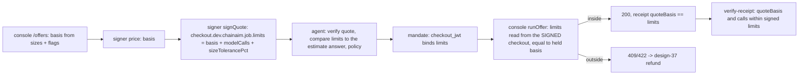

# privateAI-design-38: signed limits in the checkout ("what you signed is exactly what runs")

Chat near-ai-impl-12, 2026-11-13 ~10:30Z. Must-do item 2 of the near-ai-impl-11 table. Release target: v2.1.0.
Status: DESIGN ONLY. No code changed. Depends on design-37 for the refund when a run goes outside the limits (with the
authorization flow the same refusal simply settles nothing). Punchline: **"What you signed is exactly what runs. No bigger
model, no extra calls."**

## 0. Sources read in this chat (v2.0.0 code, repo copy chainiam-private-ai)

- packages/signer/src/index.ts: `jobCheckout()` (:65-95) writes the `dev.chainaim.job` extension with network, asset,
  payTo, amountUnits, usdcDecimals, datasetId, filesRoot, mode, and **no limits**; `BASIS_FIELDS` and
  `parsePriceRequest` (:149-180) already receive the full crossask basis (model, answerModel, phrase, userSql,
  totalBytes, files, maxPromptChars, answerMaxPromptChars, maxTokens, sqlRetries, answerMaxRows) and price from it;
  `parseAp2Quote` checks only the checkout's top-level members; `QUOTE_BASIS_FIELDS` (receipt allowlist) holds
  pricing, phrase, userSql, sqlRetries, answerMaxRows, maxPromptChars, maxTokens, files, totalBytes, calls.
- test-console/console/server.ts:1028-1058 (offer estimate: `crossaskBasis(...)`, `SIGNER.price`, `SIGNER.signQuote`
  with `pricing: { kind: "offer", basis }`, `OFFERS.hold({... basis ...})`), :386-452 (`runOffer`: `withinBasis(o.basis,
  now, OFFER_CONFIG.tolerancePct)`, crossAsk with `bs.sqlRetries / answerMaxRows / maxPromptChars /
  answerMaxPromptChars`, `gatewayChat({... maxTokens: bs.maxTokens })`, `priced` call count, receipt `quoteBasis`).
- test-console/console/offers.ts:95-114 (`crossaskBasis`, `withinBasis`), jobs.ts:106 (`meterOf`: model, promptTokens,
  completionTokens per call).
- scripts/verify-receipt.ts (:7-149): verifies the receipt, the signed quote (hash, job id, amount) and the mandate; it
  does not look at limits.
- docs/judge/sample-receipt-2026-11-13T0547Z.json: `price.quoteBasis` = {pricing estimate-first, phrase llm, userSql
  true, sqlRetries 1, answerMaxRows 50, maxPromptChars 16000, maxTokens 2048, files 1, totalBytes 2054495, calls 1}.

The gap, as found: the limits are priced by the signer and enforced by the console, but they are held only in the
console's memory (`OFFERS.hold(... basis ...)`, server.ts:1048). Neither the signed checkout nor the buyer's mandate
commits to them, so the buyer cannot prove what was agreed, and a changed console could run a larger job under the
same signed price.

**B1, verified in this chat** (services/gateway/src/chat.ts:292-301): "A model named by the client is tried alone"
(`chain = [pinned.id]`); the ranked fallback chain is only for an unnamed / `chainaim/auto` model. The console always
names the model, so the gateway cannot switch it. ARCH-682's model check compares `served[i].model`, the catalog id
that `meterOf` (jobs.ts:106) already prices by; the provider's own served-model string stays in the receipt's calls.

## 1. What changes, in one line

The signer copies the basis it priced into the checkout as `limits`; the signed checkout (and through checkout_jwt the
buyer's mandate) then binds them; the console runs from the signed limits, refuses (→ refund) a run outside them, and
verify-receipt checks the receipt against them.

## 2. Architecture



## 3. ARCH-IDs (new)

| ARCH | Requirement | Where |
|---|---|---|
| ARCH-680 | the estimate-first checkout carries `dev.chainaim.job.limits`, built by the signer from the basis it priced (never from a separate caller field) plus `modelCalls` (priced call count) and `sizeTolerancePct` | packages/signer jobCheckout, signQuote, parseQuoteRequest |
| ARCH-681 | allowlist: `limits` members checked one by one wherever a checkout comes back in (receipts, mandates, settle); unknown member → 400 by name | packages/signer parseAp2Quote |
| ARCH-682 | the console runs an offer from the signed limits: verifies the held quote with the signer's public key, requires limits == the held basis, applies them, and refuses outside them: folder size/files (409), call count (409), served model not in limits (409), completion tokens > maxTokens on any call (409), prompt chars (crossAsk already refuses) | test-console/console/server.ts runOffer, offers.ts limitsOf / withinLimits |
| ARCH-683 | the buyer agent compares the signed limits with the estimate answer's `basis` and the route before paying; a mismatch refuses with nothing signed (`mandate_scope_mismatch` style code `limits_mismatch`) | services/paywall/scripts/agent-ap2.ts, agent-jobs-core.ts |
| ARCH-684 | verify-receipt checks `price.quoteBasis` against the signed limits (equal fields, calls ≤ modelCalls, route models ⊆ limits models); a receipt whose quote has no limits (pre-v2.1.0) still verifies and says so | scripts/verify-receipt.ts, packages/receipt (helper) |

## 4. Data format

`checkout["dev.chainaim.job"].limits` (estimate-first only; run-hold quotes are priced after the run and carry none):

```json
{
  "model": "nearai/deepseek-v4.1-flash",
  "answerModel": "nearai/deepseek-v4.1-flash",
  "phrase": "llm",
  "userSql": true,
  "files": 1,
  "totalBytes": 2054495,
  "sizeTolerancePct": 5,
  "maxPromptChars": 16000,
  "answerMaxPromptChars": 8000,
  "maxTokens": 2048,
  "sqlRetries": 1,
  "answerMaxRows": 50,
  "modelCalls": 1
}
```

- `modelCalls` = `(userSql ? 0 : 1 + sqlRetries) + (phrase === "llm" ? 1 : 0)`: today's `priced` formula
  (server.ts:423), moved into packages/offer as `pricedCalls(basis)` and used by both the signer and the console.
- `sizeTolerancePct` is the console's `--offer-size-tolerance-pct` (OFFER_CONFIG.tolerancePct). It becomes a new
  QuoteRequest member `sizeTolerancePct` (int 0..100, allowlisted) because the signer cannot know it otherwise.
- Values in the example are illustrative of the shape only; the real values come from the run.
- UCP: `dev.chainaim.job` is our own extension namespace (design-33); adding a member does not change the UCP checkout
  schema's own members.

## 5. Detailed changes

### 5.1 Signer (ARCH-680, ARCH-681): packages/signer/src/index.ts

- `JobCheckoutInput` gains `limits?: CheckoutLimits`; `jobCheckout` writes it into the extension when present.
- `signQuote(r)`: when `r.pricing.kind === "offer"`, `limits = limitsOf(r.pricing.basis, r.sizeTolerancePct)` (from
  the same parsed basis that was priced, so the signed price and the signed limits cannot differ). Metered → none.
- `parseQuoteRequest`: new optional `sizeTolerancePct` (int 0..100); required when pricing is an offer (400 otherwise).
- `parseAp2Quote`: after the top-level check, check the extension's members (`network, asset, payTo, amountUnits,
  usdcDecimals, datasetId, filesRoot, mode, limits`) and inside `limits` exactly the 13 members above with their
  patterns (models: `RE.model`; ints: `int(...)`; phrase `llm|none`; userSql boolean). Anything else → 400 by name.
- `QUOTE_BASIS_FIELDS` gains `answerMaxPromptChars`, `sizeTolerancePct` (ints) so the receipt can echo them.

### 5.2 Shared helpers: packages/offer

- `pricedCalls(basis)`, `limitsOf(basis, sizeTolerancePct)`, `limitsEqualBasis(limits, basis)` (field by field, model
  strings exact), `withinLimits(limits, now: {files, totalBytes}) → string | null` (replaces `withinBasis`; same messages).
- check-deps: these live in packages/ because the signer, the console, the agent and verify-receipt all use them.

### 5.3 Console run step (ARCH-682): test-console/console/server.ts runOffer

Order inside `runOffer` (after the mandate check, before any model call):
1. `limits = o.ap2?.checkout["dev.chainaim.job"].limits`. With `--ap2 on` and no limits → 422 "the signed quote carries
   no limits" (cannot happen for a v2.1.0 signer; protects against a stale offer).
2. Verify the held quote's merchant authorization with the signer's PUBLIC AP2 key (the console already has it:
   ap2ConfigRemote) → 422 on failure (a held quote changed in memory).
3. `limitsEqualBasis(limits, o.basis)` else 422 "the held basis is not the signed limits".
4. `withinLimits(limits, folderSize now)` → 409 (today's withinBasis messages).
5. Run crossAsk with every limit taken from `limits` (not `o.basis`): sqlRetries, answerMaxRows, maxPromptChars,
   answerMaxPromptChars, maxTokens (gatewayChat), model, answerModel.
6. After the run: `served.length > limits.modelCalls` → 409 (today's check, now against the signed value); every
   `served[i].model` ∈ {limits.model, limits.answerModel} → else 409 "the job was served by <model>, not a model you
   signed for"; every `usage.completionTokens ≤ limits.maxTokens` → else 409.
7. Receipt `quoteBasis` = the limits' numeric/flag members + `pricing: "estimate-first"` + `calls: served.length`.

`--offer-limits-check on|off` (default on): `off` keeps v2.0.0 behaviour (enforce from o.basis) for one release, for a
console paired with a v2.0.0 signer; desk.ps1 never sets off.

### 5.4 Buyer agent (ARCH-683): services/paywall/scripts/agent-ap2.ts / agent-jobs-core.ts

After the existing quote verification (pinned key, job id, amount), and before the policy step:
- `limits` present (estimate-first) and `limitsEqualBasisAnswer(limits, answer.basis)` for the members the console's
  answer shows (files, totalBytes, maxPromptChars, answerMaxPromptChars, maxTokens, sqlRetries, modelCalls); the route's
  models ⊆ {limits.model, limits.answerModel}.
- Mismatch → `refused` with code `limits_mismatch`, nothing signed.
- The `quote_signed` step event gains `limits` (sizes and model ids only), shown in tab 03 under the quote.
- Spending policy (packages/agent-policy) gains an optional `maxTokensPerCall` and `allowedModels` per tenant; the
  policy reads them from the signed limits (not from the console's answer). Absent = no check (existing tenants unchanged).

### 5.5 verify-receipt (ARCH-684): scripts/verify-receipt.ts

When the file carries the signed quote and it has `limits`:
- equal: files, totalBytes, maxPromptChars, maxTokens, sqlRetries, answerMaxRows, phrase, userSql (+ answerMaxPromptChars
  and sizeTolerancePct when the receipt has them);
- `calls ≤ modelCalls`; models in `body.route` ⊆ limits models;
- OK line gains ", signed limits match"; a failure prints `FAIL limits: <field>` and exits 1.
- No limits in the quote → OK line says ", quote has no signed limits (before v2.1.0)". The judge sample
  `sample-receipt-2026-11-13T0547Z.json` therefore still verifies unchanged (its quote has no limits).

## 6. Mandate binding (no code change, stated so it is checked)

checkout_jwt in the mandate is the attached form of the merchant authorization over the whole checkout (design-36 §3.4),
so `limits` inside the checkout are covered by the mandate's checkout_hash as soon as the signer writes them. The
mandate test suite gets one new case: a checkout whose limits were altered after signing → the mandate check fails
`mandate_scope_mismatch` (ARCH-681 test).

## 7. Tests (names carry the ARCH-ID; no mocks)

| Test | File |
|---|---|
| ARCH-680 offer checkout carries limits equal to the priced basis + modelCalls + tolerance; metered has none; sizeTolerancePct required for offers | packages/signer/test/limits.test.ts |
| ARCH-681 each limits member type-checked; extra member 400 by name; altered limits fail the merchant authorization and the mandate | packages/signer/test/limits.test.ts |
| ARCH-682 run refused: grown folder 409, extra call 409, other served model 409, tokens over 409, held basis ≠ limits 422, tampered held quote 422; inside → 200 and receipt quoteBasis == limits | scripts/test/console-signer.test.ts (real console + real signer process) |
| ARCH-683 agent refuses `limits_mismatch` with nothing signed; policy allowedModels / maxTokensPerCall | services/paywall/test/agent-ap2.test.ts |
| ARCH-684 verify-receipt: v2.1.0 receipt OK with "signed limits match"; one field changed → FAIL; the 0547Z judge sample still OK | scripts/test/verify-receipt.test.ts |

## 8. Implementation steps (AI ~1 h)

0. B1 already confirmed (chat.ts:292-301). Confirm `ChatReply.model` is the catalog id in packages/crossask (meterOf prices by it).
1. packages/offer helpers + tests.
2. Signer: limits in checkout, allowlist, QuoteRequest.sizeTolerancePct + tests.
3. Console: send sizeTolerancePct, runOffer order 1-7, `--offer-limits-check` + tests.
4. Agent + policy members + tests.
5. verify-receipt + tests (judge sample unchanged).
6. STATE.md + BUILD_LOG.md (real output). No new env variable, no manual step.

## 9. Compatibility

- Old receipts and old signed quotes verify (limits optional in the extension and in verify-receipt).
- A v2.1.0 console with a v2.0.0 signer: the quote has no limits → step 1 refuses with `--offer-limits-check on`;
  desk.ps1 builds both from the same tree, so this only happens with a hand-mixed deployment (documented in
  docs/deploy/signer-cloud.md).

## 10. Wording

"What you signed is exactly what runs: the model, the number of model calls, the tokens per call and the data size are
in ChainAim's signed quote and in your agent's mandate; a run outside them is refused and refunded." Do not say the
limits are enforced by NEAR: they are enforced by ChainAim's console and provable from the signed quote and the receipt.
