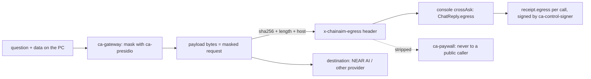

# privateAI-design-41: the egress receipt (what left your PC, proven without showing it)

Chat near-ai-impl-12, 2026-11-13 ~10:30Z. Must-do item 5 of the near-ai-impl-11 table ("1 h, if time"; order: last).
Release target: v2.1.0 if time, else v2.2.0. Status: DESIGN ONLY. No code changed. Punchline: **"See exactly what left
your PC, without seeing the content."** Lead with what stays private: the data files, the rows and the unmasked values
never leave the PC; this receipt lists every model call that did leave, with a hash of the exact bytes sent, how many
values of each kind were masked in it, and where it went.

## 0. Sources read in this chat (v2.0.0 code)

- services/gateway/src/dispatch.ts:99-145 (`attemptChat`): the provider request body is
  `payload = JSON.stringify({...body, model: deployment.servedModel, stream: false, provider: {data_collection}})`, sent
  to `${deployment.baseUrl}/chat/completions`. **Only attested deployments** (`deployment.attest === "nearai"`) encode
  the bytes once, send exactly those bytes and hash them (`requestSha256`, `responseSha256`); every other deployment
  sends the string unhashed.
- services/gateway/src/chat.ts: :260 the ledger record gets `entityCounts: countTypes(all)`, `dataClass`, `found`,
  `cardsRemoved` after masking; :263 `residual`; :292-312 model chain (a named model is tried alone); :338 `record.attest`;
  :386-389 `served`, `zone`.
- services/gateway/src/server.ts:28-57: `--expose-entity-counts` (default off) adds `x-chainaim-entity-counts` (kind →
  count) and `x-chainaim-residual` to chat replies; attested replies carry `x-chainaim-provider-id`,
  `x-chainaim-served-model`, `x-chainaim-req-sha256`, `x-chainaim-resp-sha256`.
- services/gateway/src/ledger.ts: one JSON line per request, never text, placeholders or the map.
- services/paywall/src/app.ts: `NEVER_PASS_BACK` strips exactly those six headers from public answers.
- packages/receipt/src/index.ts: `ReceiptCall {servedModel, zone?, chatId?, reqSha256?, respSha256?, attestStatus}`;
  packages/signer `parseReceiptBody` call allowlist `["servedModel","zone","chatId","reqSha256","respSha256","attestStatus"]`.

So the pieces exist but are split: masked-value counts only behind an operator flag and never in the receipt; a hash
of the sent bytes only on attested routes; no destination anywhere in the receipt.

## 1. What one egress entry says

```jsonc
"egress": [                      // NEW optional receipt member, one entry per model call, run order (ARCH-697)
  {
    "call": 0,                   // index into calls[]
    "destination": "<host>",   // host of the deployment's baseUrl from the catalog (no path, key or query)
    "zone": "private-cloud",     // the catalog zone the gateway routed to
    "sentSha256": "…",           // SHA-256 of the exact request bytes sent to the destination (masked prompt inside)
    "sentBytes": 0,              // their length
    "masked": { "PERSON": 0, "EMAIL_ADDRESS": 0 },   // entity kind -> count masked in this call (kinds and counts only)
    "residual": "pass",          // the gateway's residual check on the masked text: pass | refused
    "dataClass": "…"             // the gateway's data class for the call (e.g. phi / pii / none), as in its ledger
  }
]
```

- No value, placeholder, map, prompt or answer: the same rule as the gateway ledger and the signer allowlist (ARCH-661).
- On attested routes `sentSha256 == calls[i].reqSha256` (same bytes, ARCH-408), which ties egress to the NEAR AI
  attestation: the TEE's signed request hash is the hash of what left the PC.
- The buyer can recompute `sentSha256` locally only if it keeps the sent bytes; the console's tab 03 offers
  "download what was sent" for the owner of the run (local file only, never through the paywall). This is the "see it
  without anyone else seeing it" step.

## 2. Architecture



## 3. ARCH-IDs (new)

| ARCH | Requirement | Where |
|---|---|---|
| ARCH-695 | gateway `--expose-egress off\|on` (default off): every chat reply carries one header `x-chainaim-egress` = compact JSON `{v:1, destination, zone, sentSha256, sentBytes, masked, residual, dataClass}`; with it on, every deployment encodes the payload once and hashes those exact bytes (not only attested ones) | services/gateway dispatch.ts, chat.ts, server.ts |
| ARCH-696 | the paywall strips `x-chainaim-egress` (NEVER_PASS_BACK); a test proves a public caller never sees it | services/paywall app.ts |
| ARCH-697 | the console reads the header into `ChatReply.egress` (strict parse: unknown member → the call has no egress entry and the job log says why), and the receipt gets `egress[]`; signer allowlist checks each member; optional, older receipts verify | packages/crossask, test-console/console/receipt.ts, packages/receipt, packages/signer |
| ARCH-698 | integrity rules checked by checkBody and verify-receipt: one entry per call, `call` indexes valid, on attested calls `sentSha256 == reqSha256`, destination is a host name, counts are whole numbers ≥ 0 | packages/receipt, scripts/verify-receipt.ts |
| ARCH-699 | tab 03 "What left your PC" panel (per call: destination, zone, masked counts by kind, hash) and a local-only "download what was sent" for the run's owner; the observer view shows counts and hashes only | test-console/console/paid-jobs.html, server.ts |

## 4. Detailed changes

### 4.1 Gateway (ARCH-695)

- dispatch.ts: when `exposeEgress` is on, `const sentBytes = new TextEncoder().encode(payload)` for every deployment
  (today only for attested ones), send `sentBytes`, and return `egress: { destination: new URL(baseUrl).host,
  sentSha256: sha256Hex(sentBytes), sentBytes: sentBytes.length }`. Off → exactly today's code path.
- chat.ts: merge `masked: record.entityCounts`, `residual`, `dataClass`, `zone` into the reply's egress object.
- server.ts: header `x-chainaim-egress` (one header, compact JSON, ≤ 2 KB; entity kinds are the masker's fixed set).
  The ledger line also records `egress` (same fields), so the operator's ledger and the buyer's receipt agree.
- Flag documented in the gateway's header comment and MANUAL_SETUP.md; up.ps1 passes `--expose-egress on` when
  desk.ps1 setting `gateway.exposeEgress` is true (default true for the demo stack, false for the public router).

### 4.2 Paywall (ARCH-696)

- Add `"x-chainaim-egress"` to `NEVER_PASS_BACK`. The existing PASS_BACK regex would otherwise forward it
  (`x-chainaim-[a-z-]+`), so this line is required, not optional.

### 4.3 Console, receipt, signer (ARCH-697, 698)

- packages/crossask gatewayChat: parse the header with an allowlist parser; `ChatReply.egress?: EgressEntry`.
- receipt.ts `receiptCalls` sibling `receiptEgress(served)`; `ReceiptBody.egress?: ReceiptEgress[]`.
- Signer `RECEIPT_FIELDS` += `egress`; each entry `onlyFields(["call","destination","zone","sentSha256","sentBytes",
  "masked","residual","dataClass"])`; `masked` keys `^[A-Z_]{1,40}$`, values int; destination host pattern
  `^[a-z0-9.-]{1,253}$`.
- checkBody (ARCH-698): length == calls.length when present; attested call hash equality; else refused before signing.

### 4.4 verify-receipt and UI (ARCH-698, 699)

- verify-receipt prints `OK egress: 1 call left the PC → <host> (private-cloud), masked PERSON×n …, hash
  matches the attested request` (counts from the receipt) or FAIL with the rule broken.
- paid-jobs.html panel as in ARCH-699. "Download what was sent": console endpoint `GET /jobs/<id>/egress/<call>`,
  host check `hostOk` (127.0.0.1 only, like the other owner-only endpoints), served from the console's in-memory held
  job until it expires; never logged, never sent to the paywall or the signer.

## 5. Privacy review

- New data in the receipt: hosts, zones, entity kinds with counts, hashes, byte lengths. No content. A count can reveal
  that, e.g., 3 person names were in the question; that is already in the operator ledger and is what the buyer wants
  to see. The receipt is the buyer's document; the observer view (design-35) shows it only to whom the buyer shares it.
- The header never reaches a public caller (ARCH-696 test).

## 6. Tests (names carry the ARCH-ID; real gateway process with a local OpenAI-compatible test server, as the gateway suite does today)

| Test | File |
|---|---|
| ARCH-695 header present only with the flag; hash equals the sha256 of the bytes the test server received; masked counts equal the ledger's | services/gateway/test/egress.test.ts |
| ARCH-696 paywall strips the header for chat routes and paid jobs | services/paywall/test/headers.test.ts |
| ARCH-697 parser refuses unknown members; receipt carries egress; signer allowlist refuses a stray member | packages/crossask/test, packages/signer/test/receipt-egress.test.ts |
| ARCH-698 attested hash mismatch refused; length mismatch refused; verify-receipt OK/FAIL; judge sample still OK | packages/receipt/test, scripts/test/verify-receipt.test.ts |
| ARCH-699 panel renders; download endpoint 127.0.0.1 only and 404 after expiry | scripts/test/paid-jobs-page.test.ts |

## 7. Implementation steps (AI ~1 h; only after items 1-4 and 6 are green)

1. Gateway flag + header + ledger + tests.
2. Paywall strip + test.
3. crossask parser, receipt member, signer allowlist, checkBody + tests.
4. verify-receipt, page panel, download endpoint + tests.
5. STATE.md + BUILD_LOG.md; README claim → proof link ("what left your PC": a receipt egress line + verify output).

## 8. Wording

"Your data files and their rows stay on your PC. For every model call that left it, the receipt names where it went, how
many values of each kind were masked, and the hash of the exact bytes sent; on NEAR AI calls that hash is the one the
attested enclave signed." Never "nothing leaves your PC": masked prompts do leave, by design.
