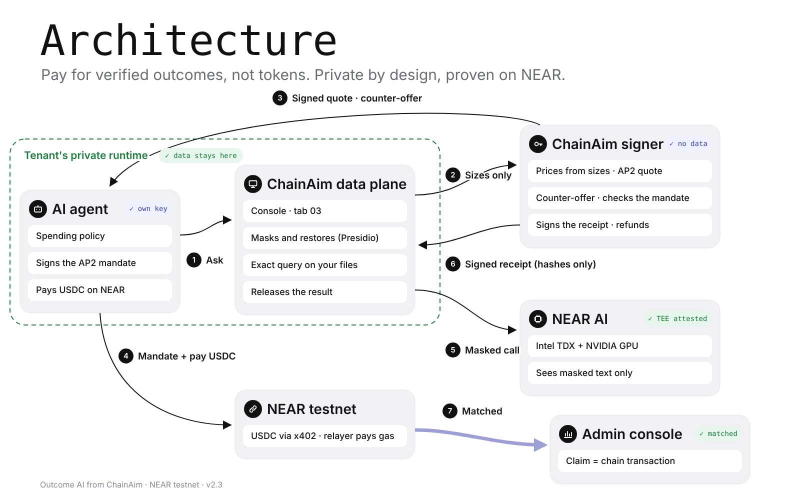

# Outcome AI from ChainAim

**Pay for verified outcomes, not tokens. Private by design, proven on NEAR.**

A business can ask AI about its own books without handing over its data, trusting numbers a model made up, or signing an
open-ended bill. Every step leaves proof that anyone can check: an attested model call, a signed price, a signed
receipt and a settlement on NEAR.

Built at **NEAR HACKATHON** (1 to 14 Nov 2026). What existed before the window and what was built in it, release by
release: [NEAR-HACKATHON-DISCLOSURE.md](NEAR-HACKATHON-DISCLOSURE.md). Architecture, step by step:
[docs/judge/outcome-ai-architecture.html](docs/judge/outcome-ai-architecture.html); on one page:
[docs/judge/outcome-ai-architecture-simple.html](docs/judge/outcome-ai-architecture-simple.html). **Live, narrated architecture walk-through:**
[https://outcomeai-architecture.vercel.app/](https://outcomeai-architecture.vercel.app/). Companion repo (live operations):
[chainaim-adminUI-NEAR](https://github.com/chainaimdev/chainaim-adminUI-NEAR).

## What makes it different

- **Unmasked only on your own machine.** The gateway, Presidio, the analyst and the console run in Docker on your PC,
  reachable on `127.0.0.1` only (Presidio not even that). Your files and your raw question never leave it: Presidio plus
  ChainAim's own patterns find names, accounts, IDs, health data and cards, and mask them **on your PC** before any text
  leaves. A residual check refuses (HTTP 422) anything that still looks personal; if the scanner is down, nothing is sent
  (fail closed). Only masked text goes to a model, and the real values are put back on your PC.
- **Numbers you can trust.** The analyst (DuckDB) computes the answer with one exact, read-only query on your files; the
  model only writes the query from column names and words the result, and every figure in its wording is checked
  against the computed result.
- **A firm price before any work.** Estimate first: ChainAim's signer sets the price from the files' sizes and signs it
  (AP2 merchant authorization), and the job runs only after payment. A failed job is never charged. Template questions cost
  0.01 to 0.02 USDC.
- **Proof, not promises.** The masked text that leaves your PC goes to NEAR AI, where each call runs in a hardware-sealed
  enclave (Intel TDX, NVIDIA GPU) and its attestation is verified for the job. Every paid job ends with an Ed25519-signed receipt that binds the files, query,
  result, model calls, price and NEAR settlement, as hashes only: the receipt never holds the data. It also lists what left
  your PC for each model call (where it went, what was masked, the hash of the exact bytes sent), and that hash is the one
  NEAR AI's enclave signed. A job whose NEAR AI attestation is not proven is refunded, not delivered.
- **AI agents that buy safely, on a two-sided deal.** A company's AI agent checks ChainAim's signed quote against its own
  spending mandate (per job, per day, auto-approve limit, attested route only), then signs its permission as an AP2
  Checkout Mandate with the tenant's own key, bound to that exact quote and that one payment, and pays in USDC on NEAR.
  ChainAim's signer verifies the mandate before the job runs; nothing settles without both signatures, and the receipt
  records both. Its own model sees the question only masked. Offered a route that is not attested, it refuses before
  anything is signed or paid.
- **Paid before the work, refunded if it fails.** The agent pays upfront in USDC on NEAR; a job that is then refused
  (attestation not proven, folder changed, outside the signed limits) is refunded on NEAR automatically, with a refund
  record signed by ChainAim. Right before paying, the agent re-checks the folder's size against the estimate.
- **A counter-offer, not a lost sale.** When a quote is above the tenant's auto-approve limit, the agent asks ChainAim for
  a smaller job at that limit. ChainAim's signer prices each smaller step (fewer answer rows, fewer tokens, fewer SQL
  tries) with the same fees and margin: **the price is never discounted, only the job shrinks**. Live: quoted 0.02,
  countered, paid 0.01, and the receipt says which offer it countered. If no smaller job fits, nothing is signed or paid.
- **Our signer never sees your data; your machine never holds our keys.** ChainAim's signing keys live in a separate
  service, `ca-control-signer` (the control plane), in its own runtime with its own keys folder. It receives sizes, ids,
  hashes and amounts only, and refuses any other field by name. Today it runs beside your stack on the same PC
  (separation by design, not by hardware); the same image runs on a cloud server (`docs/deploy/signer-cloud.md`).
- **Privacy you can check, edge included.** No question, file, query, result or answer ever goes on chain. The payment
  is an ordinary NEAR USDC transfer, so, as with any on-chain payment, its payer, amount and time are public; tab 03's
  "What the chain shows" displays exactly that for each job, read from public NEAR RPC.
- **Pay per use in USDC on NEAR.** x402 over USDC on **NEAR** (Intear wallet or an AI agent; a relayer pays the gas).
  An XRPL/RLUSD rail from the version before the hackathon is still in the code
  ([NEAR-HACKATHON-DISCLOSURE.md](NEAR-HACKATHON-DISCLOSURE.md)); paid jobs are NEAR only.
- **Any model, by name or by zone.** NEAR AI (attested), local models, OpenRouter, or Amazon Bedrock. Health data and
  `chainaim/auto` can be pinned to local zones only.
- **Live operations.** Every payment and paid job is reported to the NEAR admin UI
  ([chainaim-adminUI-NEAR](https://github.com/chainaimdev/chainaim-adminUI-NEAR)), which reconciles it with the chain.

**What runs where today, honestly:** the paywall and the relayer key still run on the buyer's PC with the data plane;
ChainAim's signer is a separate project (own network, own keys folder) on the same PC. The full desk needs Docker and
keys from the owner; the judge path below needs neither.

## Roadmap

- **Hosted mode, same guarantee.** Today the gateway runs on your PC. For businesses that want ChainAim to host it, the
  gateway moves into a confidential VM (Intel TDX) built reproducibly; your client checks the hardware-signed measurement
  against the published build before sending any raw text, and "no logs" becomes part of the measured code.
- **ChainAim's signer in a TEE.** The control plane's signer moved into a TEE whose code a NEAR contract approves
  (NEAR Shade Agents, Intel TDX), so its signing code is provable, not only separate.
- **Settle remotely, release locally.** The paywall and relayer move to the control plane and return a signed settlement;
  your PC releases the result itself, so the result never reaches a ChainAim server.
- **Spending mandate on NEAR.** The tenant's limits (per job, per day, attested route only) enforced by a NEAR contract,
  not only by the agent's code.
- **Unlinkable credits.** Prepaid credits spent as unlinkable tokens, so the chain no longer shows each job's payment.
- **Model proxy.** ChainAim holds the NEAR AI key and forwards, byte for byte, only the calls a paid, signed job allows,
  so the attested request hash still matches (built together with the hosted gateway, so the control plane still never
  sees text).
- **ChainAim Apprentice (next, design stage).** A local model learns from NEAR AI's attested model on synthetic data only,
  keeps only answers that pass deterministic checks, and is used only once it scores well: fewer calls leave your PC,
  and the receipt says which model answered.
- **ZK-PRET.** Verifiable outcomes extended to trade-finance processes and risk models (BPMN, ACTUS).

## Judges: verify it yourself, no keys

Needs only Node.js 22.22 or later and this repository: no `npm install`, no Docker, no account, no key. Run from the
repository root. Each step says what you will see.

**The sample** is a real paid job from 14 Nov 2026, 07:29Z on NEAR testnet: tenant t02's AI agent was quoted 0.02 USDC
for "Cash flow vs installment" (dataset smb-fin-1), its spending policy (auto-approve 0.01) asked for a smaller job,
ChainAim's signer offered one at 0.01 (answer rows 20, 1024 tokens), the agent signed its checkout mandate and paid
0.01 **before** the work, and the result was released only after ca-attest verified the NEAR AI call.

```powershell
# 1. The signed receipt, checked offline against the pinned public keys in config/ (receipt key, ChainAim's AP2 key,
#    the tenants' mandate keys): signature, settlement, signed quote and limits, mandate, money trail, attestation, egress.
node scripts/verify-receipt.ts --file docs/judge/sample-receipt-2026-11-14T0729Z.json --result none
#    you will see, among the details:
#            job        0ed4fe96d007925a695c7ad6226189af · quote 0ed4fe96… · counter of 043fe341c45a64c07a9c860752a30de5
#    and the last four lines:
#    OK      receipt valid: signed by the pinned key d27d1e9f17a0104e34c46cf3e5233f23, settlement signed too, signed quote matches, checkout mandate matches, signed limits match
#    OK      money trail: paid 0.010000 USDC (upfront, tx 8E6m…) · NEAR AI cost 0.000322 · gas 0.002000 · cost 0.002322 · margin 0.007678 · overrun absorbed 0.000000 (costs at ChainAim's catalog prices)
#    OK      attestation bundle matches evidenceBundleSha256 (1/1 NEAR AI calls verified)
#    OK      egress: 1 call left the PC → cloud-api.near.ai (private-cloud), masked nothing to mask, sent-bytes hash = the attested request hash on 1/1 NEAR AI call

# 2. The same payment, read from public NEAR testnet RPC (needs internet): who paid, how much and when, and what is NOT on chain.
node scripts/observe-receipt.ts --file docs/judge/sample-receipt-2026-11-14T0729Z.json
#    last line: OK      the chain shows this receipt's payment (0.01, as the receipt's price for job 0ed4fe96d007925a695c7ad6226189af)

# 3. The receipt, AP2 quote and mandate, offer pricing, observer, signer, spending-policy, console and masking-gateway tests.
node --test "packages/receipt/test/*.test.ts" "packages/ap2/test/*.test.ts" "packages/offer/test/*.test.ts" "packages/observer/test/*.test.ts" "packages/signer/test/*.test.ts" "packages/agent-policy/test/*.test.ts" "services/signer/test/*.test.ts" "test-console/test/*.test.ts" "services/gateway/test/*.test.ts"
#    you will see: # pass 565 and # fail 0 (v2.3.1, under 3 minutes)
```

`--result none`: the released answer is not published; with the result file, step 1 also checks the result hash. The
sample data is synthetic (no real company). Earlier samples: `docs/judge/older/` (the 1716Z receipt still verifies).

### Judges' map: claim, proof, how to check

| Claim | Proof | Check |
|---|---|---|
| Your raw data and question stay on your PC | Masking before any model; the receipt's egress lists what left (host, masked counts, bytes hash) | Step 1 `OK egress`; gateway tests in step 3 |
| Every NEAR AI call is attested | ca-attest's verdict per call (Intel TDX + NVIDIA GPU), its bundle hashed into the receipt; egress hash = the request hash the enclave signed | Step 1 `OK attestation`, `OK egress`; chat id at cloud.near.ai/verify |
| A firm price before any work | ChainAim's AP2 signed quote with **signed limits** (models, calls, tokens, files) | Step 1 `signed quote matches`, `signed limits match` |
| The buyer's agent spends only within its mandate | Tenant policy (per job, per day, auto-approve, attested only) and an AP2 checkout mandate signed with the tenant's key for this quote and one payment | Step 1 `checkout mandate matches`; `packages/agent-policy` tests |
| Negotiation without discounting | One counter round: a smaller job at the tenant's limit, priced by ChainAim's signer | Step 1 `counter of 043fe341…`, `max 1024 tokens`; `test-console/test/counter.test.ts` |
| Paid before the work, refunded if it fails | Upfront USDC on NEAR; refused job = signed refund record (live refund EyD53Bnv… in BUILD_LOG.md) | Step 1 `flow upfront`; step 2 |
| Real money, fair to both sides | Money trail: price, NEAR AI cost, gas, fees, margin | Step 1 `OK money trail` |
| Nothing about the content goes on chain | Only the USDC transfer is on NEAR | Step 2 `PRIVATE not on the chain: …` |
| Reconciled live | The admin UI matches every claim with the chain transfer | [chainaim-adminUI-NEAR](https://github.com/chainaimdev/chainaim-adminUI-NEAR) "Do X → see Y" |

**Architecture at a glance** (the numbers are the steps above; details in
[docs/judge/outcome-ai-architecture-simple.html](docs/judge/outcome-ai-architecture-simple.html)):



Demo video (2:30): [DEMO/outcome-ai-near-demo-2m30.mp4](DEMO/outcome-ai-near-demo-2m30.mp4) · its script:
[DEMO/script-outcome-mp4-2.5min-Nov14-1.md](DEMO/script-outcome-mp4-2.5min-Nov14-1.md) · narrated walk-through:
[docs/judge/demo-script-player-v11.html](docs/judge/demo-script-player-v11.html) · narrated architecture, step by step: **[https://outcomeai-architecture.vercel.app/](https://outcomeai-architecture.vercel.app/)**
(the same page in the repo: [docs/judge/OutcomeAI-Arch-Narration-V3.html](docs/judge/OutcomeAI-Arch-Narration-V3.html)) ·
the write-up: [below](#the-write-up-outcome-ai-in-about-1800-words).

## The write-up: Outcome AI in about 1,800 words

The narrated, step-by-step version of this story is live at **[https://outcomeai-architecture.vercel.app/](https://outcomeai-architecture.vercel.app/)** (press Play);
the same page is in the repo as [docs/judge/OutcomeAI-Arch-Narration-V3.html](docs/judge/OutcomeAI-Arch-Narration-V3.html). It walks through run A (a paid outcome after one counter-offer) in 10
steps and run B (a refund) in 4, with the real ids, hashes and transactions of 14 Nov 2026. The demo video follows the
script in [DEMO/script-outcome-ins-2m58-V2.md](DEMO/script-outcome-ins-2m58-V2.md).

### The problem

Regulated businesses sit on large volumes of sensitive data and need AI to act on it: a small company's books, an ERP
system's receivables and payables, a dental office's ledger and bank statements. Frontier AI asks them for three kinds
of trust at once. It asks them to hand over their data, to believe numbers a model may have invented, and to pay for
tokens with no clear limit, where the meter rewards spending more tokens rather than getting the right answer.

For a clinic owner or a small-business finance lead, each of those is a reason to say no. The data is protected by law
and by contracts. A wrong figure in a cash-flow answer is worse than no answer. And an open-ended token bill is not
something a business can approve in advance.

### The idea: pay for verified outcomes, not tokens

Outcome AI from ChainAim replaces that trust with proof. A business, or the business's own AI agent, buys an
**outcome**: an exact answer to a question about its own data. The price is fixed and signed before any work. The data
stays on the business's machine. The one model call that is needed runs inside an attested NEAR AI enclave and sees only
masked text. The money moves on NEAR before the work, and comes back automatically if privacy cannot be proven. Every
paid job ends with a signed receipt that anyone can check with two commands and no keys.

Our tagline says it in one line: **pay for verified outcomes, not tokens. Private by design, proven on NEAR.**

### How it is built: a private runtime, a control plane, and NEAR

The system has four parts, and the boundaries between them are the point.

**The tenant's private runtime** is the business's own machine. It runs the tenant's AI agent (with the tenant's own
keys and spending policy), the tenant's files, and ChainAim's **data plane**: the console, the analyst that runs exact
SQL on the files, the gateway with Microsoft Presidio that masks personal data, ca-attest that checks NEAR AI's
attestation, and, for now, the x402 paywall. All of it runs in Docker, with ports bound to 127.0.0.1 only. The files,
the rows, the question and the answer stay here. None of these containers holds a ChainAim signing key, and
`desk.ps1 -Planes` checks that, container by container.

**ChainAim's control plane** is the signer. It prices each job, signs the AP2 quote and its limits, verifies the
tenant's checkout mandate, signs the receipt and sends refunds. It sees job ids, file sizes, hashes, prices, the mandate
and the payment, and it refuses any other field by name: it never sees a question, a query, a row or an answer. For the
hackathon it runs as a separate container with its own Docker project, network and keys folder on the same machine, so
the separation is by design, not by hardware. Next, ChainAim hosts it.

**NEAR AI** runs the model (DeepSeek V4.1 Flash) inside a trusted execution environment, with a signed attestation
report backed by Intel TDX and NVIDIA GPU evidence.

**NEAR testnet** carries the money: USDC (NEP-141) moved over x402, relayed as a NEP-366 meta-transaction so the agent
needs no gas of its own. The chain shows who paid, how much and when, and a refund if there was one. It never shows the
question, the data or the answer. A companion admin console
([chainaim-adminUI-NEAR](https://github.com/chainaimdev/chainaim-adminUI-NEAR)) reads NEAR itself and reconciles every
payment the paywall reports with the transaction on chain.

**Where NEAR fits, concretely:**

- **NEAR AI is the only place text leaves the PC, and payment depends on its proof.** The one model call runs in a NEAR
  AI enclave; ca-attest verifies its Intel TDX + NVIDIA GPU attestation and that the enclave signed the exact bytes that
  left the PC. With "pay only for attested inference" on, no verified proof means no delivery and a refund.
- **NEAR is the payment rail for agents.** Each tenant's agent pays from its own NEAR account in USDC (NEP-141) over
  x402, relayed as a NEP-366 meta-transaction so it needs no NEAR for gas. Payment settles before the work, and a refused
  job is refunded on NEAR with an `ft_transfer` back to the payer, plus a refund record signed by ChainAim.
- **NEAR is the independent public record.** The signed receipt names the NEAR transaction; anyone can read it with
  `observe-receipt` (public RPC), and the admin console reads NEAR itself (neardata, RPC) to reconcile every payment
  the paywall claims. The chain shows payer, amount and time, never the question, data or answer.
- **Next on NEAR (roadmap):** the tenant's spending mandate enforced by a NEAR contract, and ChainAim's signer in a TEE
  whose code a NEAR contract approves (NEAR Shade Agents), so the signing code is provable, not only separate.

### A real run, step by step (run A, 14 Nov 2026)

**1. The agent asks for an outcome.** Tenant t02's AI agent asks a question about its own books: can this month's cash
flow cover a loan installment? It picks the dataset `smb-fin-1` and the template "Cash flow vs installment". The question
is checked on the PC first.

**2. A firm, signed price before any work.** The console measures the files without running anything and sends
ChainAim's signer only their sizes and hashes: 4 files, 5,395 bytes. The signer prices the job from those sizes (model
cost, a fee per model call, an analyst fee, NEAR gas and a margin, with a 0.01 minimum) and signs an AP2 quote with hard
limits: which model, how many calls, how many tokens, attestation required. The first quote is 0.02 USDC.

**3. The agent counters; only the job shrinks.** This company lets its agent auto-approve only one cent. So instead of
giving up, the agent asks once for a smaller job. ChainAim's signer walks a ladder of smaller versions of the same work,
prices each with the same fees and margin, and offers the first one that fits: answer rows 20 and at most 1,024 tokens,
at 0.01 USDC, as a new signed quote that records which offer it counters. The price is never discounted; only the job
shrinks. If nothing fits, nothing is signed or paid.

**4. Re-checked, mandated, funded on NEAR.** Right before paying, the agent re-checks the folder's size against the
estimate (a folder that grew is refused) and checks the quote against its spending policy: per job, per day, auto-approve
limit, attested route only. Then it signs an AP2 checkout mandate with the tenant's own key that permits exactly this
quote and this one payment, and pays 0.01 USDC on NEAR, before any work is done.

**5. Compute first, next to the data.** ChainAim's signer verifies the mandate. Then the heavy lifting is deterministic:
the analyst runs the exact SQL on the tenant's files, on the tenant's machine, with no model at all. The rows never
leave it. The receipt records only the SQL's and the result's hashes.

**6. Model last: one small call, masked.** Only to word the answer, the gateway masks personal data, re-scans the masked
text for anything that still looks personal (and refuses to send if it finds any, or if the scanner is down), and sends
one small request to the NEAR AI model. It records a fingerprint of the exact bytes it sent: here 896 bytes to
cloud-api.near.ai. That call cost 0.000322 USDC, about a thirtieth of a cent.

**7. Privacy proven, or no delivery.** ca-attest checks NEAR AI's hardware attestation for that exact call: Intel TDX,
NVIDIA GPU, the signature, and that the request the enclave signed has the same fingerprint as the bytes that left the
PC. Without a verified result, nothing is delivered.

**8. Result plus a signed receipt.** The answer is released, and every figure in its wording is checked against the
computed result. ChainAim signs an Ed25519 receipt that ties together the files' hashes, the query and result hashes,
both quotes, the mandate, the NEAR payment, the attestation bundle and the egress record: what left the PC, where it
went, what was masked, and the hash of the bytes. The money trail is in it too: paid 0.01, cost 0.002322 (NEAR AI
0.000322, call fees 0.001, analyst 0.002, gas 0.002), margin 0.007678.

**9. The agent checks; ChainAim sees only hashes.** The agent verifies the receipt with ChainAim's published key.
ChainAim's own operations view sees ids, hashes and payments, never the question or the data.

**10. Anyone can verify it.** A judge checks the receipt offline with one command and reads the payment from NEAR with
another. The payment is public; the content is not.

### When privacy is not proven: run B

Run B starts the same way: a signed quote, the agent's mandate, and the payment settled on NEAR before any work. The
query runs on the PC and masked text goes to NEAR AI. In this run the attestation check was switched off on purpose, so
no proof arrived, and with "pay only for attested inference" on, no proof means no delivery: the job is refused with
`attestation_not_proven`. ChainAim's signer checks the payment on chain and sends the USDC back to the buyer, with a
refund record signed by ChainAim that the agent verifies. The refund settled on NEAR about 17 seconds after the refusal.
Nobody worked unpaid, and nobody paid for an outcome they did not get.

### Who sees what

| Party | Sees | Never sees |
|---|---|---|
| Tenant's private runtime (data plane) | the files, rows, question and answer | ChainAim's signing keys |
| ChainAim's signer (control plane) | job ids, file sizes, hashes, prices, the mandate, the payment | the question, SQL, rows or answer |
| NEAR AI (TEE) | the masked question and result table, inside an attested enclave | the files; unmasked personal data |
| NEAR (anyone) | who paid, how much, when; a refund if there was one | any content |

### Use cases on the templates

ChainAim's domain expertise ships as templates, all demonstrated here on synthetic data. **ERP and small-business
finance:** from ERPNext books, cash flow against loan installments, the biggest payments out, top customers, late
payers, supplier bills due, receivables by age and credit-limit exposure. **The doctor's office:** for a dental practice
(Curve Dental exports and bank statements), every revenue leak between the practice system and the bank, money missing
versus extra, insurance EFTs per payer, card settlements that do not match, and posting errors, with model-written
explanations whose figures are checked against the computed facts. Chiropractic packs (ChiroTouch, Jane) work the same
way. Today the AI agent buys the finance and ERP templates over NEAR; the practice packs run exactly on the PC and are
next to be wired into the paid flow.

### What is real today, and what comes next

Everything above ran live on NEAR testnet; the transactions are linked in the narration page and in the receipt. Some
parts are honest first versions: the control plane is separated by design on one machine, not yet by hardware; the
paywall and its relayer key still run on the tenant's PC; payments on chain are public, as with any on-chain payment.
The design is modular, with the data plane, the control plane and settlement as separate services behind signed,
allow-listed interfaces, so each can move on its own. Next: ChainAim hosts the signer and the paywall, then runs them in
a TEE (NEAR Shade Agents or Phala Cloud) so the signing code itself is provable; the tenant's spending mandate moves into a
NEAR contract; prepaid credits make individual payments unlinkable; a model proxy lets ChainAim hold the NEAR AI key while
forwarding only the calls a paid job allows; ChainAim Apprentice teaches a local model from NEAR AI's attested model on
synthetic data; and ZK-PRET extends verifiable outcomes to trade-finance processes and risk models.

### Check it yourself

You need Node.js 22.22 or later and this repository: no install, no Docker, no account, no key. The commands are in
[Judges: verify it yourself, no keys](#judges-verify-it-yourself-no-keys): `verify-receipt` checks the signed receipt
against the public keys pinned in `config/` (expect four `OK` lines and "counter of 043fe341…"), `observe-receipt` reads
the same payment from NEAR testnet, and the test line runs 565 tests. Private data, exact numbers, a budget you control:
pay for verified outcomes, not tokens.

## Built with: AI assistance and libraries

**AI assistance.** Claude (Anthropic) was used throughout to design, write, test and document the code, under the team's
direction and review; every change was run and tested before it was released (BUILD_LOG.md). At runtime the product
calls models by name: NEAR AI Cloud (attested), Amazon Bedrock, OpenRouter or local models.

**Libraries and components** (versions in each `package.json` / Dockerfile):

| Where | What |
|---|---|
| NEAR payments | `@x402/core`, `@x402/hono`, `@x402/near`, `@x402/extensions`; `@near-js/*` (crypto, providers, signers, transactions, utils); `borsh`; `@hot-labs/near-connect` (web wallet) |
| Paywall and web | `hono`, `@hono/node-server`; `esbuild` (wallet bundles) |
| Buyer agent | `@strands-agents/sdk`, `@aws-sdk/client-bedrock-runtime`, `zod` |
| Documents | `exceljs`, `mammoth`, `unpdf` |
| Analyst | `@duckdb/node-api` (DuckDB) |
| Privacy | Microsoft Presidio analyzer (Docker image `presidio-analyzer:2.2.362`) |
| Attestation | NEAR AI's official verifier, `nearai-cloud-verifier` (built in the ca-attest image) |
| Routing | `packages/route-engine`: a fork of `router-core` (see its `NOTICE` and `docs/adr/0001`) |
| XRPL rail (pre-hackathon) | `xrpl`, `x402-xrpl`, `@x402/xrpl`, `ripple-address-codec`, `@crossmarkio/sdk` |
| Runtime | Node.js 24 (`node:24-slim`), Docker Compose |

## How to run it

Full commands with expected output: **[cmd.md](cmd.md)**. This repo runs together with
[chainaim-adminUI-NEAR](https://github.com/chainaimdev/chainaim-adminUI-NEAR).

**1. One-time setup (once per PC):** [cmd.md PART 1](cmd.md) — tools, clone both repos, packages, the local gateway key,
the secrets files in your secrets folder (outside the repository), the gateway's model mode, and the first start
(`.\test-console\up.ps1 -ReplaceRunning -Build -PayTo <XRPL pay-to>`; the pre-hackathon XRPL rail still needs any XRPL
testnet address there, while paid jobs pay on NEAR only). The admin UI repo's one-time setup comes first.

**2. Run all containers and both UIs (every day):** two commands, in this order.

```powershell
cd <your-folder>\chainaim-adminUI-NEAR
.\nearadminup.ps1              # ca-near-watch + admin UI http://127.0.0.1:8800
cd <your-folder>\chainaim-private-ai
.\test-console\up.ps1          # six backend containers + console UI http://127.0.0.1:8730
```

Stop: `.\test-console\down.ps1` here, then `.\down.ps1` in the admin UI repo.

**Or one command for both repos** (runs `nearadminup.ps1`, then `test-console\up.ps1` with the team prices, agent mode
and the saved model mode, then prints one READY table): `.\test-console\desk.ps1` · stop: `.\test-console\desk.ps1 -Stop` ·
report only: `-Check` · rebuild images: `-Build`. It needs no settings file; `config\local\desk.json` is optional.

Tab 03 agent mode (on by default when `agent-tenants.env` and a Bedrock key exist; `-Agent off` skips it) adds `ca-agent`, and tab 03 offers
"Who pays? Me — Intear Wallet / AI agent" ([cmd.md](cmd.md), "Tab 03 agent mode").

## What a teammate needs

The code, the team prices and the watch list are in the two repos. Keys and data are **not** (by design): the owner
shares the values privately, each teammate puts them in their own secrets folder, outside the repository (names in [cmd.md](cmd.md) A4).

| Need | For | Where |
|---|---|---|
| Git, Node.js 24, Docker Desktop (4 GB+) | everything | installed on the PC |
| Ollama with the team's local models | the default model mode (`ollama-cpu-8gb-all`); without it, see cmd.md A5 | installed on the PC |
| `near-testnet.env`: NEAR pay-to, relayer account and key | every NEAR payment (the relayer pays the gas) | shared by the owner |
| `chainaim.env`: `OPENROUTER_API_KEY`, `BEDROCK_API_KEY` | hosted and Bedrock models, and agent mode | shared by the owner |
| `paid-jobs.env`, `near-watch.env` | paid jobs, payment claims, job feed | generated on the PC (cmd.md A4, admin UI cmd.md A3) |
| An Intear Wallet TestNet account with TestNet USDC | paying by hand ("Me — Intear Wallet") | wallet.intear.tech, USDC from faucet.circle.com |
| `agent-tenants.env`: the tenants' NEAR keys | agent mode only | shared by the owner (cmd.md A4) |
| Data files in your data folder (`up.ps1 -PrivDataDir`) | tab 03 on your own data | copied by the teammate |

Everything below is what runs and why.

## What runs where

The backend runs in Docker (one `docker-compose.yml`); only the 8730 UI runs on your PC. All ports are published on
`127.0.0.1` only.

| Part | Container | Port on your PC | Role |
|---|---|---|---|
| 8730 UI | none (Node, `server.ts --mode ui`) | **127.0.0.1:8730** | The page and the two wallet bundles; forwards every call to console-api. Holds no key, reads no data |
| console-api | `ca-console-api` | 127.0.0.1:8735 | The console backend: files, "Ask across files", paid jobs (internal listener 8731, Docker network only), job feed |
| gateway | `ca-gateway` | 127.0.0.1:8720 | Masking, routing, model calls (Bedrock / OpenRouter / local), restore, decision ledger (no text) |
| Presidio | `ca-presidio` | none | Entity detection for the gateway |
| paywall | `ca-paywall` | 127.0.0.1:8080 | x402: quotes, verifies and settles payments (NEAR USDC, XRPL RLUSD), then proxies to the gateway |
| analyst | `ca-analyst` | 127.0.0.1:8740 | DuckDB relations and read-only SQL on your data folder |
| chain-query | `ca-chain-query` | 127.0.0.1:8750 | Read-only blockchain queries for the "Blockchain queries" panel (hidden by default with `desk.ps1`; `-ChainPanel on` shows it) |
| near-watch | `ca-near-watch` (from chainaim-adminUI-NEAR) | 127.0.0.1:8790 | Receives payment claims and job events; reconciles them with NEAR |
| agent (optional) | `ca-agent`, only with `up.ps1 -Agent on` | 127.0.0.1:8760 | Tab 03 agent mode: masks the question, asks a Strands agent on Bedrock, runs the paid job, signs the tenant's AP2 checkout mandate and pays it from the tenant's NEAR account |
| **control plane:** signer | `ca-control-signer`, its own compose project `chainaim-control-plane`, network `chainaim-control` | 127.0.0.1:8780 | ChainAim's signer: prices each job from sizes, signs the AP2 quote, verifies the agent's checkout mandate before the run, signs the receipt and its settlement. Holds ChainAim's two signing keys (from its own keys folder); sees sizes, ids, hashes and amounts only |

Every container above it is the **data plane**: your files, your question, the result and the unmasking stay there, and
none of them holds a ChainAim signing key (`.\test-console\desk.ps1 -Planes` checks this by variable name). The paywall
still runs on your PC too (moving it is on the roadmap).

```
Browser ── 8730 UI (PC) ──▶ console-api ──▶ analyst            (exact numbers from your files)
                               │      └────▶ gateway ──▶ Presidio (mask) ──▶ model (masked text only)
                               └──▶ paywall (x402: NEAR USDC / XRPL RLUSD) ──▶ gateway
paywall, console-api ──▶ near-watch (claims, job events) ──▶ admin UI 8800
console-api ──▶ ca-control-signer (control plane: price, AP2 quote, mandate check, receipt; sizes and hashes only)
```

Your data folder (`up.ps1 -PrivDataDir`) is mounted **read-only** into console-api and the analyst; the folder picker shows
it as `/data/priv-ai-data/...`. Data, secrets and program output are never in git or in an image.

## Prices

| What | Price | Where it is set |
|---|---|---|
| Paid chat, scan, mask | $0.01 each (default) | paywall `PRICE_CHAT`, `PRICE_SCAN`, `PRICE_MASK` |
| Tab 03 paid job | model cost + fees + margin, at least the minimum | `config/paid-jobs-prices.conf` (team default, committed) |

Team paid-job prices (`config/paid-jobs-prices.conf`), used automatically by `test-console\up.ps1`:

| Setting | Value |
|---|---|
| `PRICING_CATALOG` | `config/generated/catalog.local.json` (made by `switch-models.ps1`) |
| `FEE_PER_MODEL_CALL_USD` | 0.001 |
| `FEE_ANALYST_USD` | 0.002 |
| `NEAR_GAS_FEE_USD` | 0.002 |
| `MARGIN_PCT` | 20 |
| `MIN_PRICE_USD` | 0.01 |

One PC can use other prices with `paid-jobs-settings.env` in its secrets folder (same names; it wins when present).

## Repository layout

| Path | What |
|---|---|
| `services/gateway` | Masking gateway (Node built-ins only) |
| `services/presidio` | Presidio image with the extra recognizers |
| `services/paywall` | x402 paywall (NEAR and XRPL rails, paid jobs); buyer scripts in `scripts/` |
| `services/analyst` | DuckDB analysis, relations, read-only SQL |
| `services/chain-query` | Read-only chain queries |
| `services/web` | Browser wallet bundles (`wallet.js`, `near-wallet.js`) and an older private-chat page from the version before the hackathon (XRPL, Crossmark) |
| `test-console` | The console (`console/server.ts`), `up.ps1` / `down.ps1`, and the older scripts (`stack.ps1`, `switch-models.ps1`, `start-ui.ps1`, `desk.ps1`) |
| `packages/crossask` | "Ask across files" and paid-job pricing (`cost.ts`) |
| `config` | Model catalogs and registries, data-folder settings, team prices |
| `docker-compose.yml` | The backend stack |
| `services/quote-agents` | Jupiter's quote agents for Signatory (design-44); data in `sample-data/quote` |

## Quote agents (Signatory demo)

`services/quote-agents` (privateAI-design-44) is Jupiter Knitting's private data plane for Signatory's quote negotiation.
Signatory's vLEI-identified agents call it; Jupiter's stock, sailings, costs, receivables and payables stay here, and the
treasury agent never returns the unit cost.

The tenant data in `sample-data/quote` is **synthetic**, invented for this demo. Company names are used only to set the
scene: the data is not theirs, and no affiliation or endorsement is implied.

```powershell
.\test-console\desk.ps1 -Quote start                  # ca-quote-agents on 127.0.0.1:8785, rules only
.\test-console\desk.ps1 -Quote start -QuoteAi nearai  # seller synthesis by the NEAR AI TEE model via ca-gateway, attested by ca-attest
.\test-console\desk.ps1 -Quote check                  # /healthz
.\test-console\desk.ps1 -Quote stop
```

Only that one container is started or stopped. The tenant tokens go in `C:\PRIV-AI-SECRETS\quote-agents.env`
(`QUOTE_TOKEN_JUPITER`, `QUOTE_TOKEN_TOMMY`; see MANUAL_SETUP.md). Without Docker:
`node services/quote-agents/src/main.ts --ai off` (flags are listed at the top of `src/main.ts`).

| Endpoint (POST, `Authorization: Bearer <tenant token>`, `X-Agent-Alias`, `X-Agent-LEI`) | Caller alias |
|---|---|
| `/v1/tenants/jupiter-knitting/agents/inventory` `{requestId, sku, qty, shipBy}` | `JupiterInventoryAgent` |
| `/v1/tenants/jupiter-knitting/agents/logistics` `{requestId, sku, lots, deadline, allowAir}` | `JupiterLogisticsAgent` |
| `/v1/tenants/jupiter-knitting/agents/treasury` `{requestId, sku, qty, freightCents, reallocUnits, termsDays, advancePct, margins}` | `JupiterTreasuryAgent` |
| `/v1/tenants/jupiter-knitting/seller/synthesize` `{requestId, mode, inquiry, round, history, answers, authority}` | `jupiterSellerAgent`, `jupiterCeoAgent` |

`GET /healthz` needs no token. Errors are `{error:{code, message}}`. Tests: `node --test "services/quote-agents/test/*.test.ts"`.

## Tests

```powershell
node --test "services/gateway/test/*.test.ts" "scripts/test/*.test.ts" "test-console/test/*.test.ts"
npm run test:paywall
npm --prefix packages\crossask test
npm --prefix services\web test
npm --prefix services\chain-query test
npm --prefix services\analyst test
```

Last full run (v2.3.0, 14 Nov 2026, Windows `desk.ps1 -Test`): all terminal suites pass, including the paywall's 384
and the analyst's 249. `npm test` first runs a dependency check that has known, older findings, so the first line above
runs the same suites without it.

## More

| File | What |
|---|---|
| [cmd.md](cmd.md) | Every command to set up, run, check and stop |
| [DOCKERIZE-PLAN.md](DOCKERIZE-PLAN.md) | Why and how the backend moved into Docker |
| [MANUAL_SETUP.md](MANUAL_SETUP.md) | Owner steps, dated |
| [architecture.md](architecture.md) | Paid jobs (tab 03) requirements |
| [STATE.md](STATE.md), [BUILD_LOG.md](BUILD_LOG.md) | Status and the record of what ran |

Never paste `docker inspect` or `docker compose config` output anywhere: both print secret values.
